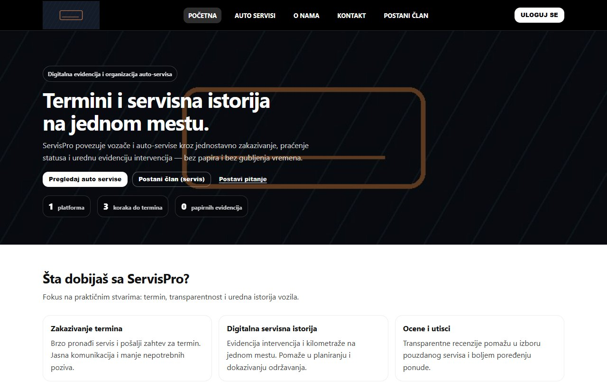

# ServisPro

**Full-stack auto-service booking · Independent Software Engineering project**

Customers can browse workshops, manage vehicles and request appointments. Workshop staff manage calendars, bookings and service history. Administrators review providers and maintain the catalogs used across roles.

[Engineering documentation ↗](https://github.com/INDZO/Softversko-Inzenjerstvo-2026) · [Architecture and setup](docs/architecture.md)

## Source layout

| Path | Contents |
| --- | --- |
| `frontend/` | React and Vite client, role-based pages, REST adapters and component tests. |
| `backend/ServisPro/` | ASP.NET Core REST API, JWT authentication, controllers, application services, EF Core models and repository implementations. |
| `docs/` | Architecture, local configuration, and a screenshot of the public release. |

## Booking demo mode

[Open the live frontend demo ↗](https://indzo-servispro-demo.vercel.app/) · In `frontend/`, run `npm ci` and `npm run build:demo`, then `npm run preview`. Use the demo banner to browse fictional workshops, filter the catalog, inspect a provider, and submit a sample appointment through the original scheduler. Requests stay in browser memory and reset on refresh. The demo has no backend, database, accounts, or external integrations. The normal frontend build and ASP.NET Core setup below are separate.

## Local development

Use Node.js 22 or later, npm, .NET 10 SDK, and a local SQL Server instance. Configure the API and apply migrations as described in [local setup](docs/architecture.md#local-setup). In `frontend`, run `npm ci` and `npm run dev`. Copy `frontend/.env.example` to `frontend/.env` only if you need to override the local API base.

The release includes actual frontend and backend code. Public artwork replaces original photos and portraits. SMTP and image uploads require developer-owned SMTP and Cloudinary configuration. This is an academic development release without production configuration or data.
